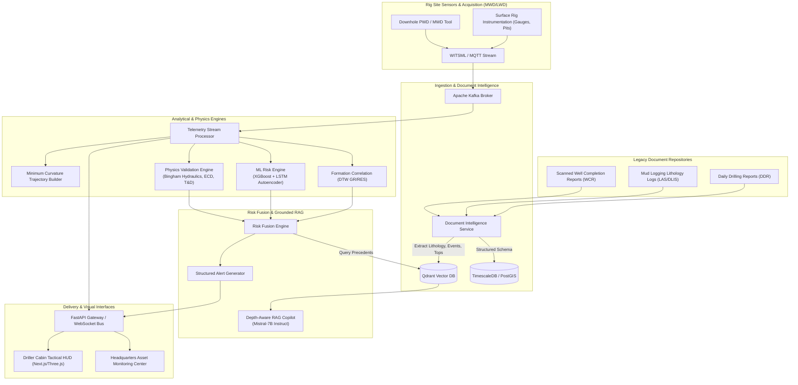
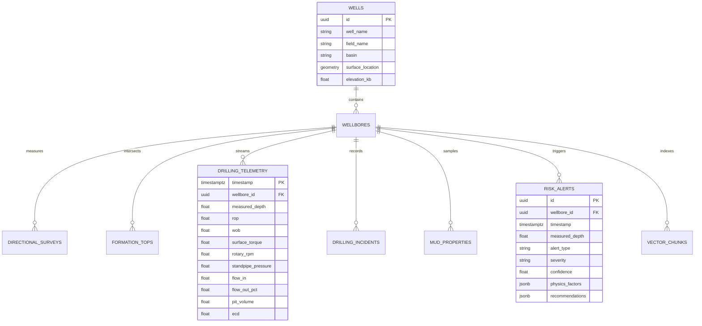

# Architecture & System Design Document
## StrataSentry-NWIS: National Well Intelligence System

---

## 1. Architectural Philosophy & Design Principles

StrataSentry is architected to address three uncompromising real-world upstream drilling constraints:
1. **Ultra-Low Latency Hazard Intervention**: Drilling hazards (such as annular pack-off or gas influx) escalate from initial sensor divergence to catastrophic stuck pipe or kick within 3–15 minutes. The end-to-end ingestion-to-alert latency must strictly not exceed **500 milliseconds**.
2. **Air-Gapped & Degraded Network Resilience**: Remote exploratory onshore rigs (e.g., remote areas in Upper Assam) and offshore deepwater floaters frequently experience satellite latency spikes (500–2,000 ms) or complete link loss. The system must operate fully autonomously at the rig-edge, with bi-directional eventual consistency synchronization.
3. **Dual-Gate Decision Fusion**: Machine learning anomaly scores must never trigger autonomous driller advisories in isolation. Every alert is mathematically validated against first-principles petroleum physics (hydraulics, mass balance, torque & drag) and cross-correlated with historical offset well evidence before elevating to high severity.

---

## 2. High-Level System Architecture

---

## 3. Core Microservices Breakdown

### 3.1 Document Intelligence Service (`services/document-intelligence`)
Transforms historical unstructured text and legacy scanned logs into deep structured datasets:
- **`parsers/`**: High-accuracy PDF layout parser, OCR engine for stamped/typed historical Indian oilfield completion reports, and tabular parser for mud schedules and casing programs.
- **`extractors/`**: Regular expression and named-entity recognition (NER) engines targeting measured depths, true vertical depths, formation tops (e.g., Tipam, Barail, Kopili), drilling events (lost circulation, pack-offs, kicks, stuck pipe), and corrective mitigations.
- **`normalizers/`**: Standardizes units (psi to bar, ppg to specific gravity, feet to meters) and resolves oilfield well nomenclature (e.g., "NHK #421", "Nahorkatiya 421", "NHK-421" -> canonical `NHK-421`).
- **`confidence/`**: Assigns probabilistic extraction confidence scores ($0.0 - 1.0$) based on OCR clarity, unit validation, and stratigraphical consistency.

### 3.2 Telemetry Ingestion Service (`services/telemetry-ingestion`)
- Ingests real-time continuous drilling streams over WITSML 1.4.1.1, WITSML 2.0 (ETP/WebSocket), and MQTT.
- Publishes to partitioned Kafka topics:
  - `rig.telemetry.raw`: 10 Hz raw sensor frames.
  - `rig.telemetry.standardized`: 1 Hz smoothed, unit-normalized, calibrated records.
  - `rig.alerts.immediate`: Sub-second hazard broadcasts.

### 3.3 Well Geometry Engine (`services/well-geometry`)
- Implements the exact petroleum industry standard **Minimum Curvature Method (MCM)**.
- Computes Dogleg Severity ($DLS$, $^\circ/30m$), true vertical depth ($TVD$), northing, easting, horizontal displacement, and 3D position vector uncertainty ellipses.
- Exposes PostGIS spatial linestring builders for true 3D spatial proximity queries against active and legacy well trajectories.

### 3.4 Formation Correlation Engine (`services/formation-correlation`)
- Employs **Dynamic Time Warping (DTW)** with geological monotonicity constraints to match active gamma ray ($GR$) and deep resistivity ($RES$) logs against nearby offset reference wells.
- Computes real-time formation entry depth predictions ahead of bit, warning drillers of approaching high-pressure shale transitions (e.g., entering Kopili or Barail coals).

### 3.5 Risk Engine (`services/risk-engine`)
- **XGBoost Classifier**: Multi-class gradient boosted decision trees trained on historical drilling incidents to output probabilities for:
  - Differential Sticking ($P_{diff}$)
  - Mechanical Hole Pack-Off ($P_{pack}$)
  - Gas Kick / Influx ($P_{kick}$)
  - Lost Circulation ($P_{loss}$)
- **LSTM Autoencoder**: Unsupervised multivariate reconstruction anomaly detector detecting subtle multi-sensor divergences before threshold triggers.

### 3.6 Physics Validation Engine (`services/physics-validation`)
- Bingham Plastic and Herschel-Bulkley non-Newtonian annular pressure loss calculations.
- Dynamic Equivalent Circulating Density ($ECD$) incorporating mud temperature, compressibility, and cuttings volumetric concentration ($C_v$).
- Soft-string Torque & Drag model back-calculating instantaneous friction factors ($\mu_{drag}, \mu_{torque}$) to isolate downhole tight spots.

### 3.7 Risk Fusion & Decision Engine (`services/risk-fusion`)
- Fuses ML probabilities, physics rule violations, and offset historical precedent:
  $$\text{Severity Index} = w_1 P_{ML} + w_2 S_{physics} + w_3 H_{offset}$$
- Generates standardized JSON alerts with severity (`INFO`, `WATCH`, `WARNING`, `CRITICAL`), estimated time-to-escalation, confidence, root cause breakdown, and standardized drilling SOP recommendations.

### 3.8 Depth-Aware RAG Engine (`services/rag-engine`)
- Employs depth-indexed semantic chunking where every chunk preserves the well name, depth interval (e.g., $2,820m - 2,860m$), stratigraphic formation, and lithology.
- Vector search via Qdrant with hybrid scalar filtering (filtering by formation and spatial radius).
- Local LLM inference (Mistral-7B / Ollama) producing grounded drill-crew recommendations with verifiable page and well citations.

---

## 4. Data Layer Architecture

- **TimescaleDB**: Hypertables partitioned on `timestamp` with automated 7-day chunking for high-frequency telemetry.
- **PostGIS**: Geographic and 3D geometry types for surface pads, well trajectories, and offset search cones.
- **Qdrant**: 768-dimensional vector collections with payload indexes on `formation_name`, `basin`, `incident_type`, and `depth_range`.

---

## 5. Security & Edge-to-Cloud Topology

1. **Air-Gapped Rig Edge**: The rig edge node runs the core API, local TimescaleDB instance, local Qdrant collection, and local ML inference workers. In the event of total satellite loss, all driller tactical displays and hazard warnings continue uninterrupted.
2. **Cryptographic Satellite Batch Sync**: When uplink is available, compressed and ChaCha20-Poly1305 encrypted WAL and telemetry deltas are pushed to the central cloud.
3. **Model Weight Verification**: All neural network and tree model checkpoints are verified against SHA-256 HMAC signatures prior to runtime loading.
